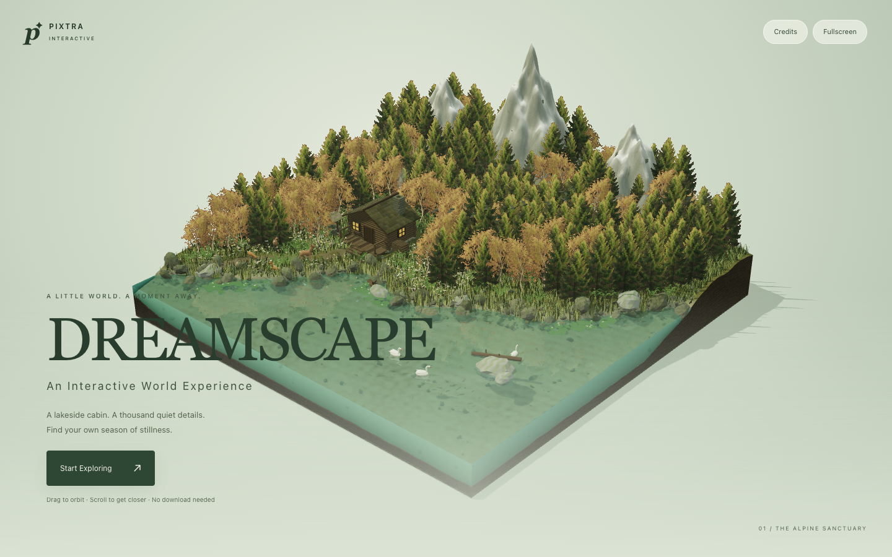

# Dreamscape · Pixtra Interactive

A quiet alpine world with a lakeside cabin, living woodland, reflective water and four changing seasons. Adapted from **Stillwild** by greenwoodpro; see [credits](CREDITS.md) and the original [MIT license](LICENSE).



## Run locally

Use Node **22.x** (22.12 or newer).

```sh
npm ci
npm run dev
```

```sh
npm run build
npm run preview
```

Drag to orbit, right-drag to pan, scroll/pinch to zoom, double-click to reset. With the canvas focused, arrow keys orbit, +/− zoom, Home resets. Use the compact season/weather menu for spring, summer, autumn, winter, clear skies, clouds, rain or winter snow. H hides/restores the interface. Fullscreen requires a browser supporting the Fullscreen API.

## Deploy to Vercel

1. Import this GitHub repository as a new Vercel project.
2. Framework preset: **Vite**. Root directory: repository root (`.`).
3. Node.js: **22.x**. Install: `npm ci`. Build: `npm run build`. Output: **dist**.
4. Environment variables: **none**. No rewrites, API routes or custom routing configuration needed.
5. Deploy using Vercel. No Vercel deployment has been performed as part of this preparation.

This is a static single-page application. All runtime assets are local. A WebGL 2 capable browser with hardware acceleration is required; the loading poster is not a replacement for live rendering. If WebGL initialization fails, the start control explains the requirement.

## Verification

The original build and live renderer were checked before changes. Production browser checks and captured desktop/mobile views are recorded in [docs/qa.json](docs/qa.json); original results are in [docs/baseline-qa.json](docs/baseline-qa.json). Screenshots are actual local Chrome captures. Browser QA uses Playwright from the parent workspace, with no test framework added to the application.

The optional upstream single-file packaging plugin was removed to avoid vulnerable build-only glob dependencies; standard Vite assets are served from `dist/`. Vite received a patch update for development-server security fixes. The game engine dependencies were preserved.

## Changes and licensing

Presentation, English controls, fullscreen, interface visibility and credits were added around the preserved world engine. See [CREDITS.md](CREDITS.md) for source commit and image provenance limitations. Do not describe the entire underlying world as an original Pixtra engine.
